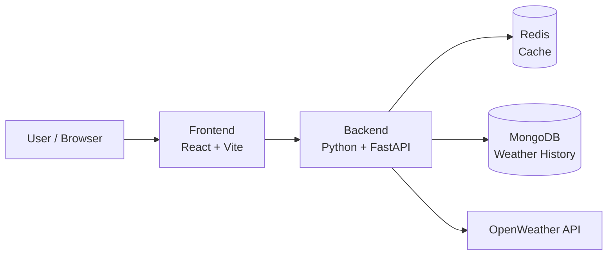
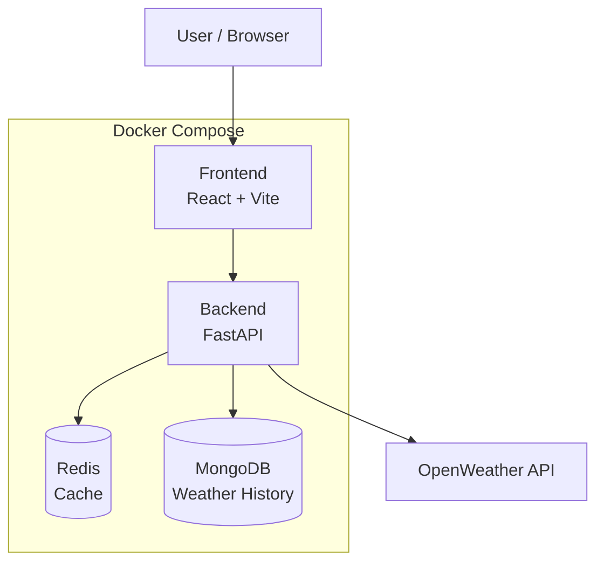
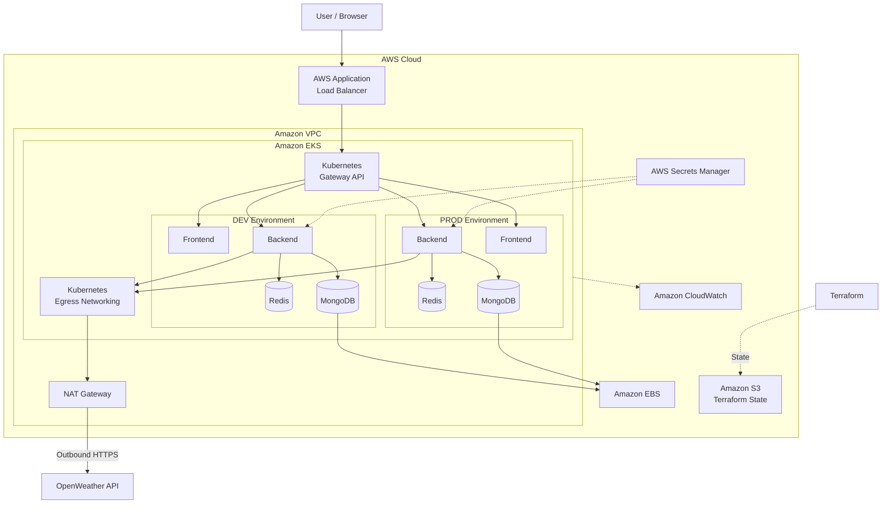

# Project Atmos — Architecture

## 1. Overview

Project Atmos is a weather application running locally with Docker Compose and in AWS on Kubernetes.

The project consists of three repositories:

| Repository | Responsibility |
|---|---|
| `project-atmos-dev` | Application, Docker, Compose, CI |
| `project-atmos-k8s` | Kubernetes and deployment configuration |
| `project-atmos-iac` | AWS infrastructure with Terraform |

---

## 2. Application Architecture



---

## 3. Technology Stack

| Area | Technology |
|---|---|
| Frontend | React + Vite |
| Backend | Python + FastAPI |
| Database | MongoDB |
| Cache | Redis |
| Containers | Docker |
| Observability | Prometheus + Grafana + Loki |
| Kubernetes | Amazon EKS |
| Kubernetes Configuration | Kustomize |
| Infrastructure | Terraform |
| Terraform State | Amazon S3 |
| CI | GitHub Actions |
| Container Registry | Docker Hub |
| External Access | AWS Application Load Balancer + Gateway API |
| Outbound Access | AWS NAT Gateway |
| Secrets | AWS Secrets Manager |

---

## 4. Local Environment

The application runs locally with Docker Compose.



Local observability:

```text
Prometheus → Grafana
Loki       → Grafana
```

---

## 5. AWS Cloud Architecture



The **AWS Application Load Balancer** is the external entry point.

**Kubernetes Gateway API** provides application routing inside the cluster.

No Nginx Ingress Controller is used.

DEV and PROD run as separate Kubernetes environments within the EKS cluster.

Outbound traffic from the cluster to the OpenWeather API goes through **Kubernetes Egress Networking** and a single **NAT Gateway** shared by DEV and PROD.

**Amazon S3** stores the Terraform remote state.

---

## 6. Deployment Process

### CI

```text
Code
  ↓
GitHub Actions
  ↓
Lint → Tests → Build
  ↓
Docker Image
  ↓
Docker Hub
```

Development images use immutable Git-based tags:

```text
<service>:<git-sha>
```

Production releases use explicit versions:

```text
<service>:v1.0.0
```

### CD

```text
Docker Hub
  ↓
Automatic DEV deployment
  ↓
Validation
  ↓
Manual approval
  ↓
PROD deployment
```

DEV delivery is fully automated.  
PROD deployment requires explicit manual approval.

---

## 7. Secrets

AWS Secrets Manager stores sensitive cloud credentials and supports credential rotation.

Secrets are made available to Kubernetes workloads through the AWS/EKS secrets integration.

MongoDB credentials are rotated using a controlled overlap:

```text
New credential
      ↓
Old + New
      ↓
Update application
      ↓
Verify
      ↓
Remove old credential
```

The rotation process is designed to avoid permanent application downtime.

Real secrets are never stored in Git.

---

## 8. AWS Services

| Service | Purpose |
|---|---|
| Amazon EKS | Kubernetes platform |
| EC2 | Worker nodes |
| VPC | Networking |
| NAT Gateway | Outbound internet access from the cluster |
| Application Load Balancer | External access |
| EBS | Persistent MongoDB storage |
| S3 | Terraform remote state |
| Secrets Manager | Secrets and credential rotation |
| CloudWatch | AWS-level monitoring |

Terraform manages the AWS infrastructure.

---

## 9. Initial Cloud Cost

The architecture uses the minimum practical AWS configuration.

DEV and PROD are logical environments within the EKS architecture, so shared AWS resources are not duplicated unnecessarily. One NAT Gateway serves both environments.

| Environment | Initial target (before NAT Gateway) |
|---|---:|
| DEV | ~`$60–70/month` |
| PROD | ~`$60–70/month` |
| **Total target** | **~`$120–140/month`** |

The NAT Gateway adds a fixed hourly charge plus per-GB data processing charges. The targets above must be re-estimated with the AWS Pricing Calculator for the `ap-northeast-2` region.

The estimate assumes low traffic, small worker nodes, minimal storage, and shared AWS infrastructure where practical.

Actual cost depends on the AWS Region, instance configuration, storage, traffic, and AWS pricing.

---

## 10. Architecture Principles

- Keep the application simple.
- Separate application, Kubernetes, and infrastructure repositories.
- Use managed AWS services where practical.
- Automate DEV delivery.
- Require manual approval for PROD.
- Use immutable image versions.
- Never store real secrets in Git.
- Keep infrastructure reproducible with Terraform.
- Minimize cloud cost.