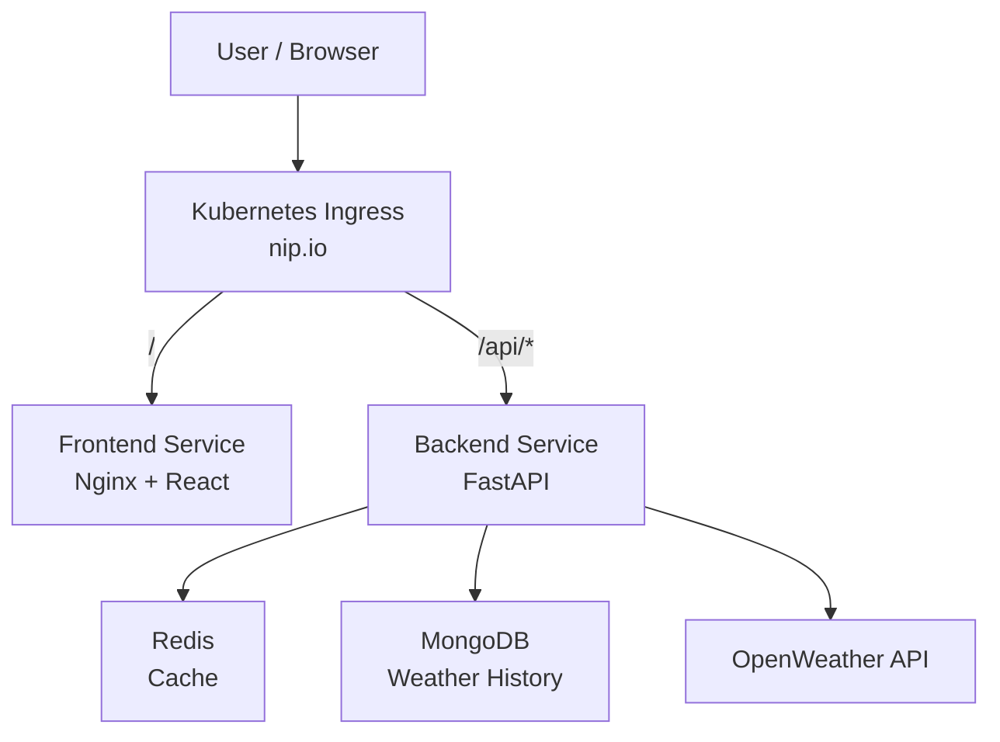

# Project Atmos — Architecture

## 1. Overview

**Project Atmos** is a real-time weather platform designed with a production-oriented DevOps architecture.

The application allows users to:

- search for current weather by city;
- cache recent requests;
- store weather history;
- run locally with Docker Compose;
- run in Kubernetes with separate `dev` and `prod` environments;
- use CI/CD, monitoring, and centralized logging.

---

## 2. Architecture



---

## 3. Technology Stack

| Layer | Technology |
|---|---|
| Frontend | React + Vite |
| Web server | Nginx |
| Backend | Python + FastAPI |
| Database | MongoDB |
| Cache | Redis |
| Containers | Docker |
| Local environment | Docker Compose |
| Orchestration | Kubernetes |
| Kubernetes configuration | Kustomize |
| External access | Ingress + nip.io |
| CI/CD | GitHub Actions |
| Container registry | Docker Hub |
| Metrics | Prometheus |
| Dashboards | Grafana |
| Logging | Loki + Grafana |

---

## 4. Components

### Frontend

React application built with Vite and served by Nginx.

Responsibilities:

- city search;
- current weather display;
- weather history display;
- loading and error states.

### Backend

FastAPI application providing the HTTP API.

Responsibilities:

- weather requests;
- weather history retrieval;
- OpenWeather API integration;
- Redis caching;
- MongoDB persistence;
- request validation and error handling.

### Redis

Used as a temporary cache for recent city lookups.

Cache data is not considered persistent application data.

Redis uses city-based cache keys with a short TTL.

Example key: `weather:<city>`

### MongoDB

Stores weather history and provides persistent application data.

MongoDB uses Kubernetes persistent storage through `PersistentVolumeClaim`.

### OpenWeather

External source of current weather data.

The OpenWeather API key is provided through a Kubernetes Secret and is not stored in the repository.

---

## 5. Request Flow

Each environment uses a single hostname for frontend and API traffic.

```text
http://<EXTERNAL-IP>.nip.io/
```

Ingress routes traffic by path:

```text
/       → Frontend Service
/api/*  → Backend Service
```

A weather request follows this flow:

```text
User
 ↓
Ingress
 ↓
Frontend
 ↓
/api/weather
 ↓
FastAPI
 ↓
Redis
 ├─ Cache HIT → return cached data
 │
 └─ Cache MISS
       ↓
   OpenWeather
       ↓
   Redis + MongoDB
       ↓
   Response
```

---

## 6. Kubernetes Architecture

A single Kubernetes cluster contains separate namespaces for `dev` and `prod`.

```text
Kubernetes Cluster
│
├── dev namespace
│   ├── Frontend
│   ├── Backend
│   ├── Redis
│   └── MongoDB
│
└── prod namespace
    ├── Frontend
    ├── Backend
    ├── Redis
    └── MongoDB
```

Kustomize is used to keep common Kubernetes resources in `base` and environment-specific configuration in overlays.

```text
k8s/
├── base/
├── overlays/
│   ├── dev/
│   └── prod/
```

Detailed environment differences are documented separately in `docs/environments.md`.

---

## 7. Local Environment

Docker Compose runs the application locally with:

- Frontend
- Backend
- MongoDB
- Redis

---

## 8. Configuration and Secrets

Application configuration is provided through Kubernetes `ConfigMap` and `Secret` resources.

Sensitive values include:

- OpenWeather API key;
- MongoDB credentials;
- other environment-specific secrets.

Real secrets are never committed to Git.

---

## 9. MongoDB Credential Rotation

MongoDB username and password are rotated by a Kubernetes CronJob.

The rotation uses a controlled transition:

```text
Create new credential
        ↓
MongoDB temporarily accepts old + new
        ↓
Update Kubernetes Secret
        ↓
Roll out Backend
        ↓
Verify new credential
        ↓
Remove old credential
```

If validation fails, the old credential remains available for recovery.

The goal is to avoid permanent application downtime during rotation.

---

## 10. CI/CD

GitHub Actions is used for CI/CD.

```text
Pull Request
     ↓
Lint
     ↓
Tests
     ↓
Build
     ↓
Docker Image
     ↓
Docker Hub
     ↓
Deploy to Dev
     ↓
Validation
     ↓
Production Release
```

Production deployment is a controlled release using an explicit image version.

Docker images use immutable versioned tags, such as the Git commit SHA for development and an explicit release version for production.

---

## 11. Observability

The observability stack consists of:

```text
Prometheus → Metrics
Loki       → Logs
Grafana    → Visualization
```

Important signals include:

- application availability;
- request count and errors;
- request latency;
- application failures;
- Kubernetes workload health.

Application logs must provide enough context to trace a failed request to its cause.

The system must support the following operational flow:

```text
Request fails
     ↓
Observe metrics / logs
     ↓
Identify cause
     ↓
Fix
     ↓
Verify recovery
```

---

## 12. Architectural Risks

| Risk | Mitigation |
|---|---|
| API key exposure | Kubernetes Secrets, no secrets in Git |
| Credential rotation failure | Old/new credential overlap and validation |
| MongoDB data loss | PersistentVolumeClaim |
| Cache loss | Redis treated as non-persistent cache |
| Image/version confusion | Explicit image tags |
| Production deployment errors | Controlled production release |
| Difficult failure investigation | Prometheus + Loki + Grafana |

---

## 13. Architecture Principles

- Keep the application layer simple.
- Use established DevOps technologies and patterns.
- Separate application responsibilities from infrastructure responsibilities.
- Keep `dev` and `prod` configuration explicit.
- Never store real secrets in Git.
- Prefer observable and reproducible operations.
- Avoid unnecessary infrastructure complexity.