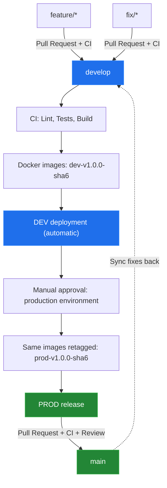

# Branching Model — Project Atmos

## 1. Overview

Project Atmos uses a branch-based development workflow to separate feature development, integration, and production releases.

The `main` branch contains stable production-ready code. The `develop` branch integrates changes before they are promoted to production.

## 2. Branch Structure

| Branch | Purpose | Source | Target |
|---|---|---|---|
| `main` | Production-ready code | `develop` | Production |
| `develop` | Development integration and testing | `main` (initial setup) | Development |
| `feature/*` | New features and functionality | `develop` | `develop` |
| `fix/*` | Bug fixes | `develop` | `develop` |
| `release/*` | Optional release stabilization | `develop` | `main` |

## 3. Development Workflow

### Feature Development

1. Create a feature branch from `develop`.
2. Implement the change and commit using Conventional Commits.
3. Open a Pull Request targeting `develop`.
4. Ensure CI checks pass.
5. Merge the Pull Request into `develop`.

Example:

`feature/weather-cache`

### Bug Fixes

1. Create a fix branch from `develop`.
2. Implement and test the fix.
3. Open a Pull Request targeting `develop`.
4. Ensure CI checks pass.
5. Merge the Pull Request into `develop`.

Example:

`fix/weather-api-timeout`

## 4. CI Pipeline

GitHub Actions runs CI on pushes and Pull Requests targeting `main` and `develop`.

The pipeline includes:

- Backend linting with Ruff.
- Backend tests with pytest.
- Frontend linting.
- Frontend production build.
- Docker image build and publication (`develop` only).

Docker images are built once, on pushes to `develop`, after the backend and frontend jobs succeed. They are published to Docker Hub with tags that include the environment, the application version, and the first 6 characters of the Git commit SHA:

- `streetflow13/project-atmos-backend:dev-v1.0.0-<sha6>`
- `streetflow13/project-atmos-frontend:dev-v1.0.0-<sha6>`

Pull Requests and pushes to `main` run the validation jobs without publishing Docker images.

## 5. Production Release Workflow

1. Changes are integrated and validated in `develop`. CI publishes the `dev-*` images and CD deploys them to DEV automatically.
2. After validation in DEV, the PROD promotion is started manually (CD workflow, with the application version and the SHA from the DEV image tag).
3. The `production` GitHub Environment requires manual approval. After approval, the validated images receive `prod-v1.0.0-<sha6>` tags. Images are never rebuilt for PROD.
4. A Pull Request is opened from `develop` to `main` to record the release. CI checks must pass.
5. The Pull Request is reviewed and merged.

The Pull Request to `main` must contain exactly the commit that was promoted. Newer commits must not be merged into `develop` between the promotion and the release Pull Request.

Application changes are not committed directly to `main`, because images are built only on `develop`. Urgent fixes follow the same path through a `fix/*` branch, `develop`, and promotion.

## 6. Release Branches and Versioning

The `release/*` branch convention is reserved for cases requiring a separate stabilization period before production.

The application version (`vMAJOR.MINOR.PATCH`) is set in `APP_VERSION` in both `ci.yml` and `cd.yml` and must be changed in both places.

Automated GitHub Releases are a planned enhancement. They are not yet part of the active release workflow.

## 7. Branch Synchronization

When production fixes need to be incorporated into development, synchronize `main` back into `develop` through a Pull Request.

This keeps both branches consistent and prevents fixes from being lost in subsequent development.

## 8. Branch Protection and Permissions

GitHub Rulesets are not enforced for this private repository under the current organization plan.

Therefore, the branching policy is currently enforced through the team's development process rather than guaranteed by GitHub branch protection.

Pull Requests and successful CI checks are the standard requirements for integrating changes. No paid GitHub plan upgrade is assumed.

## 9. Environment Mapping

| Environment | Branch | Purpose |
|---|---|---|
| DEV | `develop` | Integration and development validation |
| PROD | `main` (release record) | Stable production releases, promoted from DEV images |

Deployment to the PROD namespace is planned after the infrastructure work in `project-atmos-iac`. Until then, PROD promotion only adds the `prod-*` tags.

The deployment infrastructure is maintained separately in the `project-atmos-k8s` and `project-atmos-iac` repositories.

## 10. Repository Responsibilities

- `project-atmos-dev`: application source, Dockerfiles, CI, and image publication.
- `project-atmos-k8s`: Kubernetes manifests, Kustomize overlays, and deployment configuration.
- `project-atmos-iac`: Terraform configuration and AWS infrastructure provisioning.

This separation keeps application development, deployment configuration, and cloud infrastructure independently maintainable.

## 11. Branching Workflow Diagram

