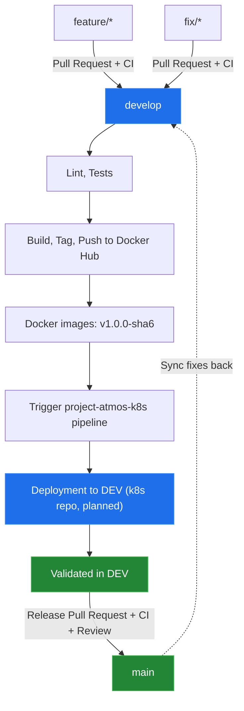

# Branching Model — Project Atmos

## 1. Overview

Project Atmos uses a branch-based development workflow to separate feature development, integration, and production releases.

The `main` branch contains stable production-ready code. The `develop` branch integrates changes before they are promoted to production.

## 2. Branch Structure

| Branch | Purpose | Source | Target |
|---|---|---|---|
| `main` | Production-ready code | `develop` | Production |
| `develop` | Development integration and testing | `main` (initial setup) | Development |
| `feature/*` | New features and functionality | `develop` | `develop` |
| `fix/*` | Bug fixes | `develop` | `develop` |
| `release/*` | Optional release stabilization | `develop` | `main` |

## 3. Development Workflow

### Feature Development

1. Create a feature branch from `develop`.
2. Implement the change and commit using Conventional Commits.
3. Open a Pull Request targeting `develop`.
4. Ensure CI checks pass.
5. Merge the Pull Request into `develop`.

Example:

`feature/weather-cache`

### Bug Fixes

1. Create a fix branch from `develop`.
2. Implement and test the fix.
3. Open a Pull Request targeting `develop`.
4. Ensure CI checks pass.
5. Merge the Pull Request into `develop`.

Example:

`fix/weather-api-timeout`

## 4. CI Pipeline

GitHub Actions runs CI on pushes and Pull Requests targeting `main` and `develop`.

The pipeline is one workflow, `ci-delivery.yml`:

- Linting (Ruff for the backend, oxlint for the frontend).
- Backend tests with pytest.
- Docker image build.
- Tagging, publication to Docker Hub, and the trigger of the deployment pipeline in `project-atmos-k8s` (`develop` only).

Image tags contain the application version and the first 6 characters of the Git commit SHA:

- `streetflow13/project-atmos-backend:v1.0.0-<sha6>`
- `streetflow13/project-atmos-frontend:v1.0.0-<sha6>`

Pull Requests and pushes to `main` build the images but do not publish them or trigger anything.

## 5. Release Workflow

1. Changes are integrated into `develop` through a Pull Request with passing CI.
2. After the merge, the pipeline runs on `develop`. On success, it publishes the images and triggers the pipeline in `project-atmos-k8s`.
3. The deployment pipeline in `project-atmos-k8s` validates the image and deploys it to DEV.
4. After validation in DEV, a Pull Request is opened from `develop` to `main` to record the release. CI checks must pass.
5. The Pull Request is reviewed and merged.

Application changes are not committed directly to `main`, because images are published only from `develop`. Urgent fixes follow the same path through a `fix/*` branch and `develop`.

Rules for PROD deployment belong to the deployment pipeline in `project-atmos-k8s` and are not defined in this repository.

## 6. Release Branches and Versioning

The `release/*` branch convention is reserved for cases requiring a separate stabilization period before production.

The application version (`vMAJOR.MINOR.PATCH`) is set in `APP_VERSION` in `ci-delivery.yml`.

Automated GitHub Releases are a planned enhancement. They are not yet part of the active release workflow.

## 7. Branch Synchronization

When production fixes need to be incorporated into development, synchronize `main` back into `develop` through a Pull Request.

This keeps both branches consistent and prevents fixes from being lost in subsequent development.

## 8. Branch Protection and Permissions

GitHub Rulesets are not enforced for this private repository under the current organization plan.

Therefore, the branching policy is currently enforced through the team's development process rather than guaranteed by GitHub branch protection.

Pull Requests and successful CI checks are the standard requirements for integrating changes. No paid GitHub plan upgrade is assumed.

## 9. Environment Mapping

| Environment | Branch | Purpose |
|---|---|---|
| DEV | `develop` | Integration and development validation |
| PROD | `main` (release record) | Stable production releases |

This repository only publishes images. Deployment to the DEV and PROD namespaces is performed by the pipeline in `project-atmos-k8s`, which is planned.

The deployment infrastructure is maintained separately in the `project-atmos-k8s` and `project-atmos-iac` repositories.

## 10. Repository Responsibilities

- `project-atmos-dev`: application source, Dockerfiles, and the CI-Delivery pipeline (checks, build, tag, push, trigger).
- `project-atmos-k8s`: Kubernetes configuration and the deployment pipeline.
- `project-atmos-iac`: Terraform configuration and AWS infrastructure provisioning.

This separation keeps application development, deployment configuration, and cloud infrastructure independently maintainable.

## 11. Branching Workflow Diagram

